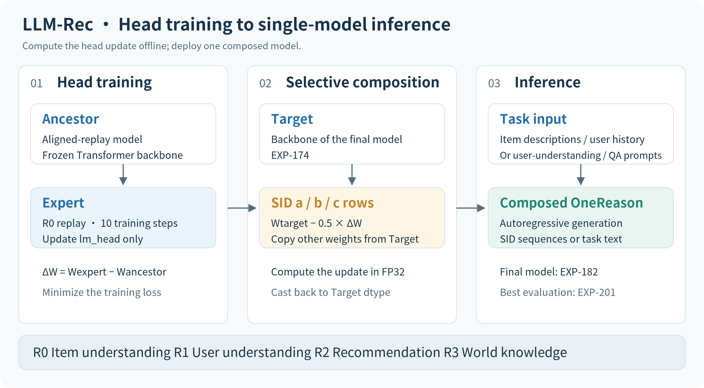
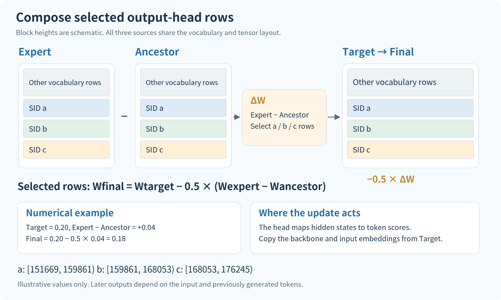
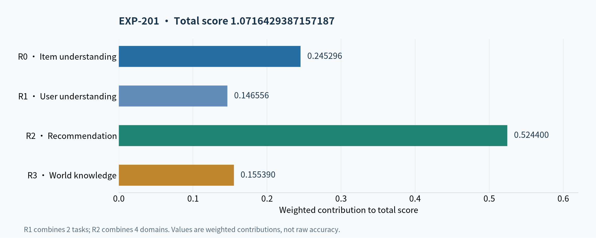

# LLM-Rec: Output-Head Tuning and Selective Weight Composition

[简体中文（默认）](README.md) | **English**

The Kuaishou Explorer LLM-Rec Challenge evaluates a single model on item understanding, user understanding, recommendation, and general knowledge. This solution starts from **OneReason-0.8B** and concentrates the final parameter changes in the output rows for semantic IDs: freeze the backbone, train the output head, then apply the resulting weight difference to selected rows of a target model with a coefficient of **−0.5**.

The final model is **EXP-182**. Its best official evaluation score is **1.0716429387157187**, recorded in evaluation EXP-201. Weight composition happens offline; inference uses a single model.



[View SVG](assets/solution-overview.en.svg)

| Item | Final configuration |
|---|---|
| Base model | `OneReason-0.8B-pretrain-competition` |
| Training | Freeze the Transformer backbone; train `lm_head` for 10 steps |
| Composition scope | SID groups a, b, and c: 24,576 output-head rows |
| Composition formula | `Target − 0.5 × (Expert − Ancestor)` |
| Deployment | One composed causal language model |
| Best total score | **1.0716429387157187** |

**Contents:** [Tasks and data representation](#tasks-and-data-representation) · [Solution design](#solution-design) · [Output-head training](#output-head-training) · [Selective weight composition](#selective-weight-composition) · [Inference and evaluation](#inference-and-evaluation) · [Code guide](#code-guide)

## Tasks and data representation

### Four task groups in one model

The competition evaluates several recommendation-related capabilities within one language model. Each task has its own inputs and metrics. Depending on the task, the model generates item identifiers, writes natural language, or selects an answer.

| Task group | Input and objective | Metric |
|---|---|---|
| R0: Item understanding | Generate an item's itemic pattern from its content description | Pass@64 |
| R1: User understanding | Identify interest relationships from historical behavior and generate topics describing interest evolution | Action-selection F1 and composite topic-generation F1 |
| R2: Multi-domain recommendation | Predict the next item from user history across video, e-commerce, advertising, and live streaming | Pass@64 for each domain |
| R3: World knowledge | Answer general-knowledge multiple-choice questions | Single-answer accuracy |

Pass@64 measures whether the target appears among the candidates. The model needs to assign probability to the right SID sequences while retaining its ability to understand users and answer knowledge questions. All four groups contribute to the final score, motivating a local adjustment to the output layer.

### Representing items as tokens

OneReason represents items using Semantic IDs (SIDs). An itemic pattern consists of a domain prefix followed by three semantic tokens:

```text
<|domain_begin|> <s_a_i> <s_b_j> <s_c_k>
     domain     level 1 level 2 level 3
```

Each semantic codebook has 8,192 entries. The three tokens are generated in sequence and jointly encode an item. The domain prefix identifies the recommendation context.

| Context | Domain prefix | Domain value in the data |
|---|---|---|
| Short video | `<\|video_begin\|>` | `video/video` |
| E-commerce | `<\|prod_begin\|>` | `goods` |
| Advertising | `<\|ad_begin\|>` | `video/ad` |
| Live streaming | `<\|living_begin\|>` | `live` |

For example, `<|video_begin|><s_a_123><s_b_456><s_c_789>` illustrates the format for a short-video item. These numbers are examples and do not identify a real item or user.

Item records are joined by `(domain, pid)`. `Pid2Sid` supplies the three-level codes, `Pid2Caption` supplies content descriptions, and `UserProfile` supplies user histories across domains. Together, they support description-to-SID and history-to-SID prediction. Natural language and SIDs share a vocabulary, with all token scores produced by the same output head.

## Solution design

### What changes when the output head is tuned

Let the hidden state at a decoding step be $h\in\mathbb{R}^{d}$ and the output head be $W\in\mathbb{R}^{V\times d}$, where $V$ is the vocabulary size. Each token score is the inner product of its weight row and the hidden state:

$$
z = Wh,\qquad z_j = W_j h.
$$

The Transformer backbone encodes the context into a hidden state. The output head maps that state to the vocabulary. Changing the rows associated with SIDs changes their scores in the current context. The final solution restricts parameter changes to these rows.

The training and composition scopes differ: **the entire `lm_head` is trainable, but composition uses only its a, b, and c rows**. Updates to other output-head rows are not included in the final model.

### The roles of the three models

| Name | Role | Model |
|---|---|---|
| Ancestor | Starting point for output-head training and reference point for the weight difference | aligned-replay v8t freeze8 |
| Expert | Model after 10 output-head training steps from Ancestor | Training output with the headfix and Liger gradient fix |
| Target | Supplies the final backbone and original output head | EXP-174 |

Ancestor and Expert form a pair: subtracting their weights gives the update produced by this training run. Target receives that update and does not have to equal Ancestor.

The chosen coefficient is $-0.5$, which applies half the update in the opposite direction. Training still minimizes the usual cross-entropy loss; reversal and scaling happen during offline composition. This coefficient belongs to the selected final configuration and does not establish that reversing updates will help other tasks or models.

## Output-head training

### Training inputs and frozen parameters

Supervised fine-tuning starts from the aligned-replay model, using the `takeover_r0_cbalanced_replay_v1` dataset and the `qwen3_nothink` template. This training produces the output-head update direction, while Target supplies the body of the deployed model.

The configuration sets the number of trainable Transformer layers to zero and lists `lm_head` as an additional trainable module. The optimizer therefore updates only the output head. Multiple examples are packed into long sequences, with neat packing enabled.

| Parameter | Setting |
|---|---|
| Fine-tuning mode | `freeze`, with `freeze_trainable_layers: 0` |
| Additional trainable module | `lm_head` |
| Optimization steps | 10 |
| Learning rate | `1e-5` |
| Schedule | Cosine, with warmup ratio `0.03` |
| Per-device batch size | 1 |
| Gradient accumulation | 16 |
| Maximum sequence length | 32,768 |
| Weight decay / gradient clipping | `0.0` / `1.0` |
| Precision / attention | FP16 / xFormers |
| Random seed | 20260720 |

See the [output-head training configuration](07_接管/experiments/configs/exp182_headfix_reproduction_step10_fp16_xformers_ligerfix.yaml) for the complete settings.

### Preserving head gradients with a frozen backbone

For a valid target token $y$, the loss is $-\log\operatorname{softmax}(Wh)_y$. Even when $h$ comes from a frozen backbone, the loss still has a gradient with respect to $W$, so the output head should continue learning.

The Liger 0.6.4 fused cross-entropy implementation gates the weight-gradient computation path on whether its input requires gradients. Hidden states from a frozen backbone normally do not. When the output head is trainable, the patch makes the hidden state a new local leaf tensor:

```python
_input = _input.detach().requires_grad_(True)
```

This enables the fused operator to compute output-head gradients. `detach()` disconnects the tensor from the preceding graph; the backbone parameters remain frozen.

The [training entry point](07_接管/experiments/run_frozen_head_training.py) loads the [gradient patch](07_接管/experiments/liger_frozen_head_patch.py) through `sitecustomize` and checks the relevant Liger source version. This handles the particular combination of freezing and fused loss used here without changing the cross-entropy objective.

## Selective weight composition

### Defining the final weights row by row

Let $S$ be the selected SID rows. The output-head update is:

$$
\Delta W = W_{\mathrm{expert}} - W_{\mathrm{ancestor}}.
$$

The final output head is computed row by row:

$$
W_{\mathrm{final},j} =
\begin{cases}
W_{\mathrm{target},j} - 0.5\Delta W_j, & j\in S,\\
W_{\mathrm{target},j}, & j\notin S.
\end{cases}
$$

All parameters outside `lm_head` come directly from Target, including the Transformer backbone and input embeddings. The code uses the following half-open vocabulary ranges:

| SID group | Token ID range | Rows |
|---|---|---:|
| a | `[151669, 159861)` | 8,192 |
| b | `[159861, 168053)` | 8,192 |
| c | `[168053, 176245)` | 8,192 |
| Total | `[151669, 176245)` | **24,576** |



[View SVG](assets/head-composition.en.svg)

For illustration, suppose a selected Target weight is 0.20 and Expert increases that weight by 0.04 relative to Ancestor. The composed value is `0.20 − 0.5 × 0.04 = 0.18`. These are example values, not measurements from the model.

### How a local parameter change affects generation

For the same input prefix, the final model and Target use the same backbone parameters. At a fixed hidden state $h$, the logit change for a selected token is therefore:

$$
\Delta z_j = -0.5\Delta W_j h,\qquad j\in S.
$$

The effect depends on the inner product between the weight difference and the current context representation. A negative coefficient does not lower every SID score: that inner product can be positive or negative.

Unselected rows retain their raw logits at the same hidden state, but their probabilities can change because other token scores affect the softmax denominator. Generation is also autoregressive: choosing a different token changes the subsequent context. Selecting only some output-head rows limits the parameter changes; it does not leave every other output probability unchanged.

### Numerical computation and export

The [composition script](07_接管/experiments/compose_selective_lm_head_task_vector.py) checks the three models' configurations, vocabulary sizes, tensor inventories, and shapes before computing the result. Subtraction and scaling use FP32, with results cast back to Target's parameter dtype before writing.

After export, the script recomputes the expected weights and checks the saved tensors. Selected rows must satisfy the composition formula; all other rows and parameters must match Target. Configuration and tokenizer files are also copied from Target, preserving the model structure and vocabulary of the exported directory.

## Inference and evaluation

### Generation with a single model

Inference loads the exported final model. R0 generates candidate SIDs from item descriptions; R2 predicts the next item from user history and a recommendation instruction. R1 and R3 produce the topics, judgments, or multiple-choice answers required by their tasks.

In the preliminary-round evaluation, R0 uses non-thinking beam64. R2 combines 32 thinking candidates and 32 non-thinking candidates and scores whether the target appears among the 64. These are evaluation-side generation settings. Offline weight composition adds no inference branch and does not require loading Ancestor or Expert for each request.

### Final score

| Metric | Score |
|---|---:|
| **Total** | **1.0716429387157187** |
| R0: Item understanding | 0.2452961672473868 |
| R1: User understanding, two subtasks combined | 0.14655643689584122 |
| R2: Multi-domain recommendation, four domains combined | 0.5244 |
| R3: World knowledge | 0.1553903345724907 |



[View SVG](assets/evaluation.en.svg)

The total is the sum of eight weighted subtask contributions, grouped into R0–R3 above. The R0 weight is 17.6; both R1 weights are 0.3. R2 weights for video, e-commerce, advertising, and live streaming are 9.6, 3.4, 1.4, and 0.9, respectively. The R3 weight is 0.3. The reported components are already weighted: they are not raw accuracies, and the bar heights do not measure gains from individual modules.

These results come from evaluation EXP-201 of model EXP-182. The record is available in [results.json](docs/results.json).

## Code guide

The code follows the sequence of launching training, fixing the gradient path, composing the output head, and checking the export. To read the core method first, start with `compose_head` in the composition script, which directly implements the piecewise formula above.

| File | Purpose |
|---|---|
| [Training configuration](07_接管/experiments/configs/exp182_headfix_reproduction_step10_fp16_xformers_ligerfix.yaml) | Frozen parameters, data template, and 10-step training settings |
| [run_frozen_head_training.py](07_接管/experiments/run_frozen_head_training.py) | Load the patch and launch training |
| [liger_frozen_head_patch.py](07_接管/experiments/liger_frozen_head_patch.py) | Handle local gradients with a frozen backbone |
| [compose_selective_lm_head_task_vector.py](07_接管/experiments/compose_selective_lm_head_task_vector.py) | Apply the negative half-step difference to a/b/c rows |
| [merge_model_weights.py](07_接管/experiments/merge_model_weights.py) | Load models, define directory conventions, and check compatibility |
| [finalize_exp182_ligerfix.py](07_接管/experiments/finalize_exp182_ligerfix.py) | Check training steps and the final model |

The composition command takes the following form. The three directories need compatible `model.safetensors`, configuration, and tokenizer files, and their paths must follow the workspace conventions used by the helper module.

```bash
python 07_接管/experiments/compose_selective_lm_head_task_vector.py \
  --ancestor /path/to/ancestor \
  --target /path/to/exp174 \
  --expert /path/to/head-expert \
  --groups a,b,c \
  --alpha=-0.5 \
  --output-name exp182-negative-half-abc
```

The model is written to `07_接管/experiments/selective_task_vector_models/`, with its records in `manifests/`. Choose an unused output name. Full model weights and training data must be supplied separately.

## References

- [OneReason competition base model](https://huggingface.co/OpenOneRec/OneReason-0.8B-pretrain-competition)
- [Competition dataset and field descriptions](https://huggingface.co/datasets/OpenOneRec/Explorer_LLM_Rec_Competition)
- [OneReason Technical Report](https://arxiv.org/abs/2606.06260)
