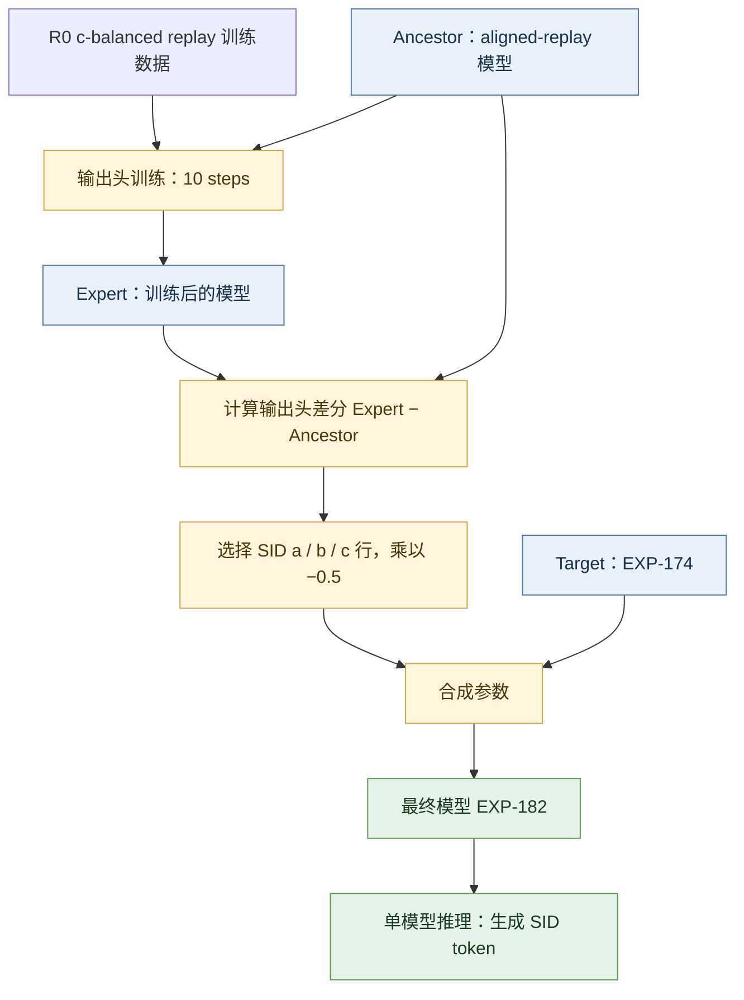
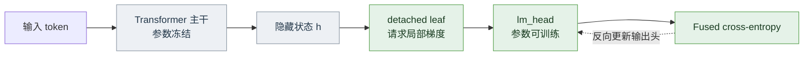
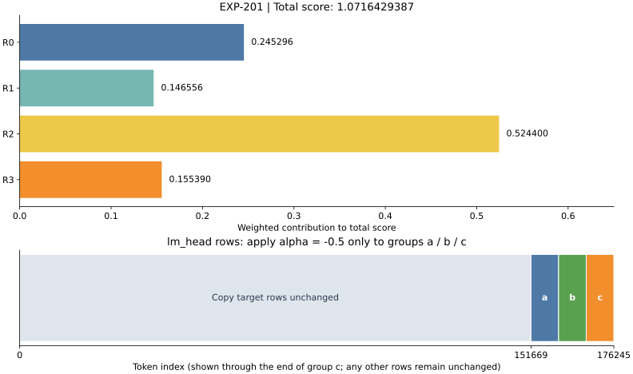

# LLM-Rec：输出头微调与选择性权重合成

本方案在推荐模型上微调输出头，再将训练得到的权重变化反向应用到指定的 SID token 上。最终模型为 EXP-182，正式评测最高分为 **1.0716429387157187**，对应 EXP-201 评测记录。

## 整体架构

方案包含离线训练、参数合成和模型推理三个阶段。训练阶段从一个 aligned-replay 模型中提取输出头的更新方向；合成阶段将这个方向反向、缩小后写入目标模型的指定行；推理阶段加载合成后的单个模型生成推荐结果。



三个模型在合成时承担不同作用。Ancestor 决定差分的起点，Expert 提供这次训练学到的变化，Target 提供最终模型的主体参数。合成结束后，推理不再需要同时加载这三个模型。

| 阶段 | 输入 | 主要操作 | 输出 |
|---|---|---|---|
| 训练 | Ancestor、R0 replay 数据 | 冻结主干，更新输出头 | Expert |
| 合成 | Ancestor、Expert、Target | 在 SID 行上应用负半幅差分 | EXP-182 参数 |
| 推理 | 合成模型、推荐任务输入 | 自回归生成 token | 推荐对象的 SID |

## 方案思路

推荐对象通过 SID（语义标识符）表示，模型需要生成对应的 token。输出头 `lm_head` 将隐藏状态映射为词表分数，其中 a、b、c 三组 token 对应本方案调整的 SID 区域。

训练和合成分开进行。先从 aligned-replay 模型出发，冻结 Transformer 主干，只训练 `lm_head`，得到一个输出头更新方向。随后以 EXP-174 为目标模型，把这一方向乘以 −0.5，应用到 a、b、c 三组 SID 对应的行。目标模型的其余参数保持原值。

这样可以单独调整 SID 的输出分数，而不必把此次训练产生的全部参数变化写入目标模型。

## 输出头训练

训练使用 `takeover_r0_cbalanced_replay_v1` 数据，模板为 `qwen3_nothink`。主干冻结后，仅输出头参与参数更新，训练共 10 步。

| 参数 | 设置 |
|---|---|
| 可训练模块 | `lm_head` |
| 学习率 | `1e-5` |
| 学习率调度 | cosine，warmup ratio 为 0.03 |
| 单卡 batch size | 1 |
| 梯度累积 | 16 |
| 最大序列长度 | 32768 |
| 精度 | FP16 |
| Attention | xFormers |
| 数据打包 | packing、neat packing |
| 随机种子 | 20260720 |

完整参数见 [训练配置](07_接管/experiments/configs/exp182_headfix_reproduction_step10_fp16_xformers_ligerfix.yaml)。

### 训练中的前向与反向路径

输出头接收主干产生的隐藏状态，将其映射为词表上的 logits。主干不参与参数更新，损失仍需对输出头求梯度。冻结范围与梯度计算范围因此需要分别处理。



对于隐藏状态矩阵 $H$ 和输出头权重 $W$，词表分数由 $Z=HW^T$ 得到。训练只更新 $W$，不会因输出头损失而改变主干参数。这里的训练仍按正常损失最小化进行；负系数只出现在训练完成后的参数合成阶段。

### Liger 梯度修复

冻结主干后，输入输出头的隐藏状态不需要梯度，但 `lm_head` 仍然需要更新。这里使用的 Liger 0.6.4 fused cross-entropy 实现依据输入的 `requires_grad` 决定是否分配权重梯度，因而需要额外处理这种情况。

[补丁](07_接管/experiments/liger_frozen_head_patch.py)在输出头可训练、输入不需要梯度时执行：

```python
_input = _input.detach().requires_grad_(True)
```

新的叶子张量支持局部反向传播，同时切断通往冻结主干的梯度路径。[训练入口](07_接管/experiments/run_frozen_head_training.py)通过 `sitecustomize` 将补丁传入训练子进程，并校验对应 Liger 源文件的哈希。

## 选择性权重合成

合成使用三个模型：`ancestor` 是输出头训练的初始模型，`expert` 是训练 10 步后的模型，`target` 是 EXP-174。对选定的输出头行，计算：

```text
W_final = W_target - 0.5 × (W_expert - W_ancestor)
```

三个 SID 分组使用左闭右开的词表区间：

| 分组 | token 区间 |
|---|---|
| a | `[151669, 159861)` |
| b | `[159861, 168053)` |
| c | `[168053, 176245)` |

[合成代码](07_接管/experiments/compose_selective_lm_head_task_vector.py)先以 FP32 计算差分，再转回目标参数的数据类型。未选中的输出头行，以及所有非 `lm_head` 参数，直接取自 `target`。保存后会重新计算并逐张量比较，检查输出是否符合合成公式。

```bash
python 07_接管/experiments/compose_selective_lm_head_task_vector.py \
  --ancestor /path/to/ancestor \
  --target /path/to/exp174 \
  --expert /path/to/exp182-head-expert \
  --groups a,b,c \
  --alpha=-0.5 \
  --output-name exp182-negative-half-abc
```

三个输入目录需包含兼容的模型权重与配置，路径需符合辅助模块的工作区约定。

### 合成的数值约束

合成代码先检查三个模型的架构字段、词表大小和张量清单是否兼容。差分以 FP32 计算，写入结果前再转换为 Target 的参数类型，减少直接在低精度类型中相减造成的舍入影响。

| 参数区域 | 写入规则 |
|---|---|
| a、b、c 三组 `lm_head` 行 | `Target − 0.5 × (Expert − Ancestor)` |
| 其余 `lm_head` 行 | 从 Target 原样复制 |
| 非 `lm_head` 张量 | 从 Target 原样复制 |

例如，某个被选中位置的 Target 参数为 0.20，Expert 相对 Ancestor 增加了 0.04，最终值就是 `0.20 − 0.5 × 0.04 = 0.18`。这是公式示例，用于说明负半幅更新的方向，不是实际模型参数。

生成文件后，代码会重新计算结果，并对保存的每个张量做一致性比较；源模型文件也会再次校验，避免合成过程中输入发生变化。检查通过后记录输入哈希、合成系数和输出文件信息。

## 评测结果

| 总分 | R0 | R1 | R2 | R3 |
|---:|---:|---:|---:|---:|
| **1.0716429387157187** | 0.2452961672473868 | 0.14655643689584122 | 0.5244 | 0.1553903345724907 |

分项与总分取自 [EXP-201 正式评测记录](docs/results.json)。图中上半部分按同一尺度显示各分项对总分的贡献，下半部分标出输出头中参与合成的 SID 行。



这些分项是汇总后的加权贡献，不是同一量纲下的原始准确率。R2 的数值最大，但不能据此单独推断某个模块的改进幅度。输出头示意图画到 c 组的右边界；词表中其他行同样遵循原样复制规则。

## 使用流程

阅读代码时，可以从合成器开始了解最终参数的来源，再查看输出头训练配置和 Liger 补丁。若需要调用合成器，应先准备三个相互兼容的模型目录，各目录包含 `model.safetensors`、模型配置以及 tokenizer 文件。


合成命令中的 `--alpha=-0.5` 和 `--groups a,b,c` 对应最终方案。输出目录名必须是新的名称，代码会拒绝覆盖已有结果。输入模型仍受仓库路径规则约束，数据和权重需另行准备。

## 代码结构

| 文件 | 功能 |
|---|---|
| `07_接管/experiments/configs/` | 输出头训练参数 |
| `run_frozen_head_training.py` | 加载 Liger 补丁并启动训练 |
| `liger_frozen_head_patch.py` | 冻结主干场景下的梯度修复 |
| `compose_selective_lm_head_task_vector.py` | SID 分组上的权重合成 |
| `merge_model_weights.py` | 模型读取、兼容性检查与文件操作 |
| `finalize_exp182_ligerfix.py` | 检查训练步数、合成参数和输出张量 |

表中的 Python 文件均位于 `07_接管/experiments/`。依赖包括 PyTorch、Safetensors、PyYAML、LLaMA-Factory、Liger Kernel 和 xFormers。数据与模型权重需另行准备。
